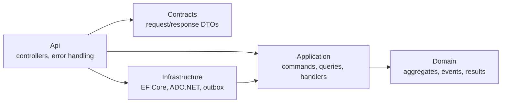

# CqrsApiExample

*Português: [README.pt-br.md](README.pt-br.md)*

An ASP.NET Core Web API (.NET 10) that shows Clean Architecture and CQRS end to end. The domain
is deliberately small (users), so the code is about the plumbing a real API needs: commands and
queries without a mediator library, a persistence-ignorant domain, domain events delivered through
a transactional outbox, two interchangeable persistence providers (EF Core and plain ADO.NET),
consistent error responses, and tests at every layer.

## What it shows

- **CQRS without MediatR.** The project's own `ICommand`/`IQuery`/`IRequestHandler` contracts.
  Every handler is wrapped in decorators (logging → validation) composed at startup, and each
  controller action receives its handler as a parameter, so its dependency is explicit.
- **A persistence-ignorant domain.** No EF Core, no attributes, no NuGet packages. Aggregates
  protect their invariants through factories that return the project's own `Result<T>`, and
  errors carry stable codes (`User.NotFound`, `User.DuplicateEmail`).
- **Separate write and read sides.** Commands load aggregates through repositories and commit
  with a unit of work. Queries project straight to read models with `AsNoTracking()`.
- **Transactional outbox.** Domain events are saved in the same transaction as the changes and
  delivered by a background service: at-least-once, exponential backoff, a dead letter after the
  last attempt, per-handler idempotency, and safe with several API instances.
- **Two persistence providers, one flag.** `Persistence:Provider` picks EF Core or hand-written
  ADO.NET behind the same interfaces, with the same outbox guarantee. Both are instrumented with
  logs and a metrics histogram, and compared with BenchmarkDotNet.
- **Consistent errors.** Every error, including the ones the framework raises (unknown route,
  malformed JSON, 405, 415), is an RFC 9457 ProblemDetails with `errorCodes` and a `traceId`.
- **Tests per layer.** Unit tests, integration tests against a real SQL Server (Testcontainers),
  HTTP tests with `WebApplicationFactory`, and architecture tests that enforce the layer rules.

## Tech stack

.NET 10 · ASP.NET Core · SQL Server 2022 · EF Core 10 · Microsoft.Data.SqlClient ·
FluentValidation · OpenAPI + Swagger UI · xUnit · FluentAssertions · Moq · Testcontainers ·
NetArchTest · BenchmarkDotNet · Docker Compose

## Getting started

You need the [.NET 10 SDK](https://dotnet.microsoft.com/download) and Docker.

**Everything in containers** (SQL Server + API):

```bash
docker compose up --build
```

**Or only the database in Docker**, with the API running locally (better for debugging):

```bash
docker compose up db
dotnet run --project src/Api
```

Then open <http://localhost:5235/swagger>. The OpenAPI document is at `/openapi/v1.json`.

In the Development environment the API applies the EF Core migrations and seeds one user
(Jane Doe). SQL Server listens on `127.0.0.1:14330` (database `CqrsApi`) with a local-only SA
password; set `MSSQL_SA_PASSWORD` to use another one. Outside Development nothing is applied
automatically: run the migrations as a deployment step and provide `ConnectionStrings__Database`.

[`_requests/users.rest`](_requests/users.rest) is a guided tour of the API for the VS Code
[REST Client](https://marketplace.visualstudio.com/items?itemName=humao.rest-client) extension,
error cases included.

## API

| Method | Route | Success | Errors |
|---|---|---|---|
| `GET` | `/api/users` | `200` list ordered by creation date | |
| `GET` | `/api/users/{id}` | `200` the user | `400 User.InvalidId`, `404 User.NotFound` |
| `POST` | `/api/users` | `201` with `Location` | `400` validation, `409 User.DuplicateEmail` |

```http
POST /api/users
Content-Type: application/json

{ "name": "John", "surname": "Doe", "email": "john@doe.com" }
```

Errors use `application/problem+json`. Clients should branch on `errorCodes`, not on the messages:

```json
{
  "type": "User.DuplicateEmail",
  "title": "Email is already in use.",
  "status": 409,
  "traceId": "00-4bf92f3577b34da6a3ce929d0e0e4736-00f067aa0ba902b7-01",
  "errorCodes": ["User.DuplicateEmail"]
}
```

A route that doesn't exist (including a non-GUID id) answers `404 Request.NotFound`, and a body
that can't be parsed answers `400 Request.Invalid`.

## Architecture



Dependencies point inward, and the architecture tests fail if a layer reaches outward.
A request goes through:

1. The controller builds a command or query and calls its handler.
2. Decorators log the request and run its FluentValidation validator.
3. The handler uses the domain and the persistence abstractions, and returns a `Result<T>`.
4. The controller turns the result into a response, or into a ProblemDetails.
   Unexpected exceptions go to a global handler, which logs them once and answers `500`.

More detail:

- [`docs/architecture/c4-model.md`](docs/architecture/c4-model.md): C4 diagrams (context,
  containers, components, the `POST /api/users` flow through the outbox, deployment).
- [`CLAUDE.md`](CLAUDE.md): the design rules and the reasons behind them (outbox guarantees, the
  provider flag, error codes, naming conventions).

## Configuration

| Key | Values | Default |
|---|---|---|
| `ConnectionStrings:Database` | SQL Server connection string | none outside Development |
| `Persistence:Provider` | `Ado` or `EfCore` | `Ado` in `appsettings.json` |

Environment variables use `__` as the separator (`Persistence__Provider=EfCore`). With Compose:
`PERSISTENCE_PROVIDER=EfCore docker compose up`.

The persistence metrics are published on the `CqrsApiExample.Persistence` meter:

```bash
dotnet-counters monitor -n CqrsApiExample.Api --counters CqrsApiExample.Persistence
```

## Tests

```bash
dotnet test CqrsApiExample.slnx                       # all tests (Docker must be running)
dotnet test tests/Domain.UnitTests                    # one project
dotnet test --filter "Category=Architecture"          # by category
```

| Project | Covers |
|---|---|
| `Domain.UnitTests` | entity invariants, equality, domain events, `Result<T>` |
| `Application.UnitTests` | handlers, validators, decorators, the handler pipeline |
| `Infrastructure.IntegrationTests` | both providers on a real SQL Server: mapping, unique index, unit of work, outbox processing, read side, metrics |
| `Api.UnitTests` | controller actions, global exception handler, ProblemDetails shapes |
| `Api.IntegrationTests` | the whole API over HTTP, run once per provider |
| `Architecture.Tests` | layer dependencies and conventions on the compiled assemblies |

Integration tests start one SQL Server container per test assembly. The infrastructure tests get a
new database per test; the HTTP tests share the database of the API instance they call and use
unique emails.

## Benchmarks

EF Core versus ADO.NET for reads (list, get by id, email lookup) and writes (insert with the
outbox row). They start their own SQL Server container:

```bash
dotnet run -c Release --project benchmarks/Persistence.Benchmarks
dotnet run -c Release --project benchmarks/Persistence.Benchmarks -- --filter *Read*
```

Reports are written to `BenchmarkDotNet.Artifacts/results/`.

## Project structure

```text
src/
  Domain/            aggregates, domain events, Result<T>, error codes
  Application/       commands, queries, handlers, validators, decorators, abstractions
  Infrastructure/    EF Core and ADO.NET persistence, migrations, outbox, email sender
  Contracts/         request and response DTOs
  Api/               controllers, ProblemDetails, dependency injection, Program.cs
tests/               one test project per layer, plus architecture tests
benchmarks/          EF Core vs ADO.NET (BenchmarkDotNet)
docs/architecture/   C4 model
_requests/           users.rest (REST Client)
```

Build settings and package versions are central (`Directory.Build.props`,
`Directory.Packages.props`). Warnings, code style violations and vulnerable packages fail the build.
Run `dotnet format CqrsApiExample.slnx` before committing.

## License

[MIT](LICENSE)
