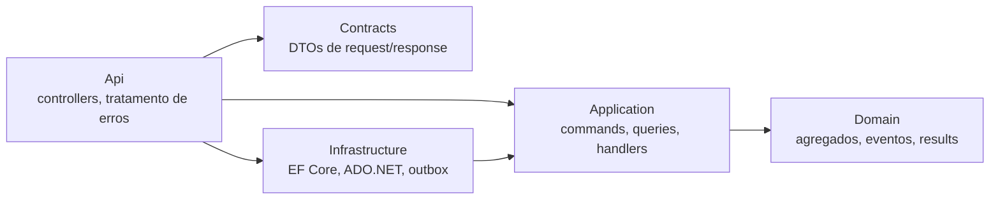

# CqrsApiExample

*English: [README.md](README.md)*

Uma Web API ASP.NET Core (.NET 10) que mostra Clean Architecture e CQRS de ponta a ponta. O domínio
é pequeno de propósito (usuários), então o código trata da infraestrutura que uma API real precisa:
commands e queries sem biblioteca de mediator, um domínio que ignora a persistência, eventos de
domínio entregues por um outbox transacional, dois provedores de persistência intercambiáveis
(EF Core e ADO.NET puro), respostas de erro consistentes e testes em todas as camadas.

## O que o projeto mostra

- **CQRS sem MediatR.** Contratos próprios `ICommand`/`IQuery`/`IRequestHandler`. Cada handler é
  envolvido por decorators (logging → autorização → validação) montados na inicialização, e cada action do
  controller recebe o seu handler como parâmetro, então a dependência fica explícita.
- **Um domínio que ignora a persistência.** Sem EF Core, sem atributos, sem pacotes NuGet. Os
  agregados protegem suas invariantes por meio de factories que retornam o `Result<T>` do próprio
  projeto, e os erros têm códigos estáveis (`User.NotFound`, `User.DuplicateEmail`).
- **Lados de escrita e de leitura separados.** Os commands carregam agregados por repositórios e
  confirmam com uma unit of work. As queries projetam direto para modelos de leitura com
  `AsNoTracking()`.
- **Outbox transacional.** Os eventos de domínio são gravados na mesma transação que as alterações
  e entregues por um serviço em segundo plano: pelo menos uma vez (*at-least-once*), backoff
  exponencial, *dead letter* depois da última tentativa, idempotência por handler, e seguro com
  várias instâncias da API.
- **Dois provedores de persistência, uma flag.** `Persistence:Provider` escolhe EF Core ou ADO.NET
  escrito à mão por trás das mesmas interfaces, com a mesma garantia do outbox. Os dois são
  instrumentados com logs e um histograma de métricas, e comparados com BenchmarkDotNet.
- **Autenticação com JWT.** O cadastro grava um hash PBKDF2 da senha; `POST /api/auth/login`
  emite um access token HS256 de vida curta. Todo endpoint exige token, a não ser que declare
  `[AllowAnonymous]` (uma fallback policy), e um teste de arquitetura obriga cada action a dizer qual.
- **Autorização nos casos de uso.** Cada request declara quem pode enviá-la (`IAdminOnlyRequest`,
  `IOwnerOrAdminRequest`) e um decorator aplica a regra a partir do token: membros leem só a si
  mesmos, administradores leem qualquer um. Um membro recebe `403` para o id de outra pessoa, exista
  ele ou não, então a resposta nunca confirma um id.
  Cada linha registra quem a criou e alterou por último (`CreatedBy`/`ModifiedBy`), a partir do mesmo token.
- **HTTP endurecido.** Listas são paginadas (no máximo 100 por página). Login e cadastro têm limite
  de requisições por IP, o resto por usuário; acima do limite a API responde `429` com `Retry-After`.
  Toda resposta leva headers de segurança (`nosniff`, bloqueio de frames, uma CSP restrita), o CORS só
  libera as origens configuradas e o Kestrel limita o corpo das requisições a 64 KB.
- **Acesso ao banco com privilégio mínimo.** A API conecta como `cqrs_api_app`, um login que só lê e
  grava linhas nos próprios schemas (uma role criada por migration). Migrations e seed rodam como
  `sa`, só na inicialização em Development. Testes de integração provam que o login não altera o schema.
- **Erros consistentes.** Todo erro, inclusive os que o framework gera (rota inexistente, JSON
  malformado, token ausente, 405, 415), é um ProblemDetails (RFC 9457) com `errorCodes` e um `traceId`.
- **Testes por camada.** Testes unitários, testes de integração contra um SQL Server real
  (Testcontainers), testes HTTP com `WebApplicationFactory` e testes de arquitetura que garantem as
  regras entre camadas.

## Tecnologias

.NET 10 · ASP.NET Core · SQL Server 2022 · EF Core 10 · Microsoft.Data.SqlClient ·
FluentValidation · OpenAPI + Swagger UI · xUnit · FluentAssertions · Moq · Testcontainers ·
NetArchTest · BenchmarkDotNet · Docker Compose

## Como rodar

Você precisa do [SDK do .NET 10](https://dotnet.microsoft.com/download) e do Docker.

**Tudo em contêineres** (SQL Server + API):

```bash
docker compose up --build
```

**Ou só o banco no Docker**, com a API rodando localmente (melhor para depurar):

```bash
docker compose up db
dotnet run --project src/Api
```

Depois abra <http://localhost:5235/swagger>. O documento OpenAPI fica em `/openapi/v1.json`.

No ambiente Development, a API aplica as migrations do EF Core e cria um administrador inicial
(`jane.doe@example.com`, senha `JaneDoe.Dev.2026`, só para uso local). Quem se cadastra é membro. O SQL Server escuta em `127.0.0.1:14330` (banco `CqrsApi`) com uma senha de SA só para
uso local; defina `MSSQL_SA_PASSWORD` para usar outra. Fora de Development nada é aplicado
automaticamente: rode as migrations como uma etapa do deploy e forneça `ConnectionStrings__Database`.

[`_requests/users.rest`](_requests/users.rest) é um tour guiado pela API para a extensão
[REST Client](https://marketplace.visualstudio.com/items?itemName=humao.rest-client) do VS Code,
incluindo os casos de erro.

## API

| Método | Rota | Token | Sucesso | Erros |
|---|---|---|---|---|
| `POST` | `/api/users` | não | `201` com `Location` | `400` validação, `409 User.DuplicateEmail`, `429` |
| `POST` | `/api/auth/login` | não | `200` access token | `400` validação, `401 Auth.InvalidCredentials`, `429` |
| `GET` | `/api/users?page=1&pageSize=20` | admin | `200` uma página, mais antigos primeiro | `400 Paging.*`, `401 Request.Unauthorized`, `403 Auth.Forbidden` |
| `GET` | `/api/users/{id}` | dono ou admin | `200` o usuário | `400 User.InvalidId`, `401`, `403 Auth.Forbidden`, `404 User.NotFound` |

```http
POST /api/users
Content-Type: application/json

{ "name": "John", "surname": "Doe", "email": "john@doe.com", "password": "pelo menos 8 caracteres" }
```

Depois faça login e envie o token nas rotas protegidas:

```http
POST /api/auth/login
Content-Type: application/json

{ "email": "john@doe.com", "password": "pelo menos 8 caracteres" }
```

```json
{ "accessToken": "eyJhbGciOi...", "tokenType": "Bearer", "expiresIn": 1800 }
```

```http
GET /api/users
Authorization: Bearer eyJhbGciOi...
```

Uma lista responde uma página: `{ "items": [...], "page": 1, "pageSize": 20, "totalCount": 42, "totalPages": 3 }`.

No Swagger UI, use o botão **Authorize**. Senha errada e email desconhecido recebem o mesmo
`401 Auth.InvalidCredentials`, então a API nunca revela quais emails têm conta. Um token ausente,
expirado ou com assinatura inválida recebe `401 Request.Unauthorized` com o header `WWW-Authenticate`.

Os erros usam `application/problem+json`. Os clientes devem decidir pelos `errorCodes`, não pelas
mensagens:

```json
{
  "type": "User.DuplicateEmail",
  "title": "Email is already in use.",
  "status": 409,
  "traceId": "00-4bf92f3577b34da6a3ce929d0e0e4736-00f067aa0ba902b7-01",
  "errorCodes": ["User.DuplicateEmail"]
}
```

Uma rota que não existe (inclusive um id que não é GUID) responde `404 Request.NotFound`, e um corpo
que não pode ser lido responde `400 Request.Invalid`.

## Arquitetura



As dependências apontam para dentro, e os testes de arquitetura falham se uma camada aponta para
fora. Uma requisição passa por:

1. O controller monta um command ou query e chama o seu handler.
2. Os decorators registram a requisição no log e rodam o validador FluentValidation dela.
3. O handler usa o domínio e as abstrações de persistência, e retorna um `Result<T>`.
4. O controller transforma o resultado numa resposta, ou num ProblemDetails.
   Exceções inesperadas vão para um handler global, que as registra uma vez e responde `500`.

Mais detalhes:

- [`docs/architecture/c4-model.pt-br.md`](docs/architecture/c4-model.pt-br.md): diagramas C4
  (contexto, contêineres, componentes, o fluxo do `POST /api/users` pelo outbox, deployment).
- [`CLAUDE.md`](CLAUDE.md) (em inglês): as regras de design e os motivos por trás delas (garantias
  do outbox, a flag de provedor, códigos de erro, convenções de nomes).

## Configuração

| Chave | Valores | Padrão |
|---|---|---|
| `ConnectionStrings:Database` | connection string do SQL Server | nenhum fora de Development |
| `ConnectionStrings:Migrations` | conexão de administrador para migrations e seed (só em Development) | usa `Database` |
| `Persistence:Provider` | `Ado` ou `EfCore` | `Ado` no `appsettings.json` |
| `Jwt:SigningKey` | pelo menos 32 bytes; assina e valida os tokens | nenhum fora de Development |
| `Jwt:Issuer`, `Jwt:Audience` | emissor e audiência do token | `CqrsApiExample`, `CqrsApiExample.Api` |
| `Jwt:AccessTokenLifetime` | `hh:mm:ss` | `00:30:00` |
| `RateLimiting:Global` | `PermitLimit`, `Window` por usuário (ou IP) | `300` por `00:01:00` |
| `RateLimiting:Authentication` | login e cadastro, por IP | `10` por `00:01:00` |
| `Cors:AllowedOrigins` | origens de navegador que podem chamar a API | nenhuma |

A chave de assinatura é como a connection string: não está no `appsettings.json`, então cada
ambiente precisa fornecer a sua (`Jwt__SigningKey`), e a API não inicia sem uma chave válida.
Localmente dá para manter segredos fora dos arquivos com `dotnet user-secrets set Jwt:SigningKey "..." --project src/Api`;
nos outros ambientes use variáveis de ambiente ou um cofre (por exemplo o Azure Key Vault).

Em Development e no Compose a API conecta com o login de privilégio mínimo `cqrs_api_app`
(`MSSQL_APP_PASSWORD` troca a senha local); o `sa` (`ConnectionStrings:Migrations`) só aplica as
migrations, cria esse login e faz o seed. Em produção, crie um login uma vez, coloque o usuário dele
na role `cqrs_api_app_role` e dê à API apenas esse login.

Variáveis de ambiente usam `__` como separador (`Persistence__Provider=EfCore`). Com o Compose:
`PERSISTENCE_PROVIDER=EfCore docker compose up`.

As métricas de persistência são publicadas no meter `CqrsApiExample.Persistence`:

```bash
dotnet-counters monitor -n CqrsApiExample.Api --counters CqrsApiExample.Persistence
```

## Testes

```bash
dotnet test CqrsApiExample.slnx                       # todos os testes (o Docker precisa estar rodando)
dotnet test tests/Domain.UnitTests                    # um projeto
dotnet test --filter "Category=Architecture"          # por categoria
```

| Projeto | Cobre |
|---|---|
| `Domain.UnitTests` | invariantes das entidades, igualdade, eventos de domínio, `Result<T>` |
| `Application.UnitTests` | handlers, validadores, decorators, o pipeline de handlers |
| `Infrastructure.IntegrationTests` | os dois provedores num SQL Server real: mapeamento, índice único, unit of work, processamento do outbox, lado de leitura, métricas |
| `Api.UnitTests` | actions dos controllers, handler global de exceções, formato dos ProblemDetails |
| `Api.IntegrationTests` | a API inteira via HTTP, rodada uma vez por provedor |
| `Architecture.Tests` | dependências entre camadas e convenções, nos assemblies compilados |

Os testes de integração sobem um contêiner SQL Server por assembly de teste. Os testes de
infraestrutura ganham um banco novo por teste; os testes HTTP compartilham o banco da instância da
API que chamam e usam e-mails únicos.

## Integração contínua

O GitHub Actions (`.github/workflows`) roda em todo push na `main` e em todo pull request:

| Workflow | O que verifica |
|---|---|
| `ci.yml` → `build-and-test` | build (warnings e pacotes vulneráveis o derrubam), `dotnet format`, todos os testes (Docker no runner) |
| `ci.yml` → `secrets` | gitleaks em todo o histórico (`.gitleaks.toml` lista as credenciais de desenvolvimento, só locais) |
| `ci.yml` → `container` | Trivy: a imagem Docker (HIGH/CRITICAL derrubam o job) e a configuração do Dockerfile/compose |
| `ci.yml` → `dependency-review` | só em pull requests: nenhuma dependência nova com vulnerabilidade conhecida |
| `codeql.yml` | análise estática do CodeQL no código C# e nos workflows, também semanal |

O Dependabot (`.github/dependabot.yml`) abre pull requests semanais de atualização dos pacotes NuGet, das
GitHub Actions e das imagens base do Docker. Nas configurações do repositório, ative também o secret
scanning com push protection, as atualizações de segurança do Dependabot e o code scanning, para que os
resultados acima cheguem à aba Security.

## Benchmarks

EF Core contra ADO.NET em leituras (listar, buscar por id, verificar e-mail) e escritas (insert com
a linha do outbox). Eles sobem o próprio contêiner SQL Server:

```bash
dotnet run -c Release --project benchmarks/Persistence.Benchmarks
dotnet run -c Release --project benchmarks/Persistence.Benchmarks -- --filter *Read*
```

Os relatórios vão para `BenchmarkDotNet.Artifacts/results/`.

## Estrutura do projeto

```text
src/
  Domain/            agregados, eventos de domínio, Result<T>, códigos de erro
  Application/       commands, queries, handlers, validadores, decorators, abstrações
  Infrastructure/    persistência EF Core e ADO.NET, migrations, outbox, envio de e-mail
  Contracts/         DTOs de request e response
  Api/               controllers, ProblemDetails, injeção de dependência, Program.cs
tests/               um projeto de teste por camada, mais os testes de arquitetura
benchmarks/          EF Core vs ADO.NET (BenchmarkDotNet)
docs/architecture/   modelo C4
_requests/           users.rest (REST Client)
```

As configurações de build e as versões de pacotes são centralizadas (`Directory.Build.props`,
`Directory.Packages.props`). Avisos, violações de estilo de código e pacotes vulneráveis quebram o
build. Rode `dotnet format CqrsApiExample.slnx` antes de commitar.

## Licença

[MIT](LICENSE)
