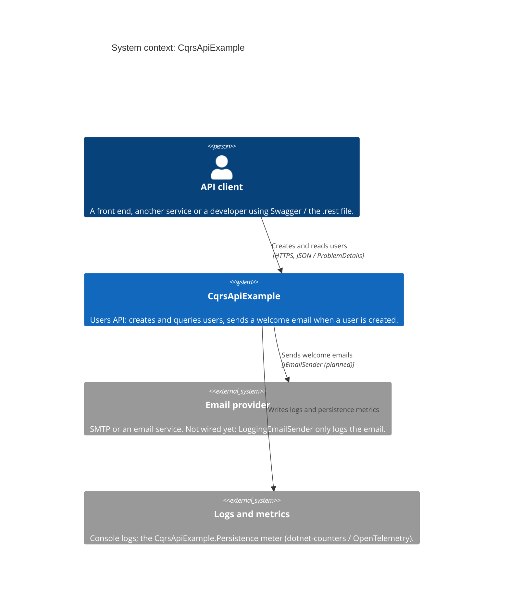
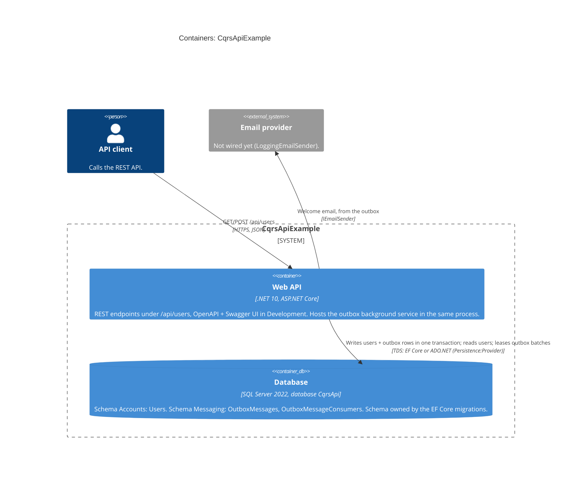
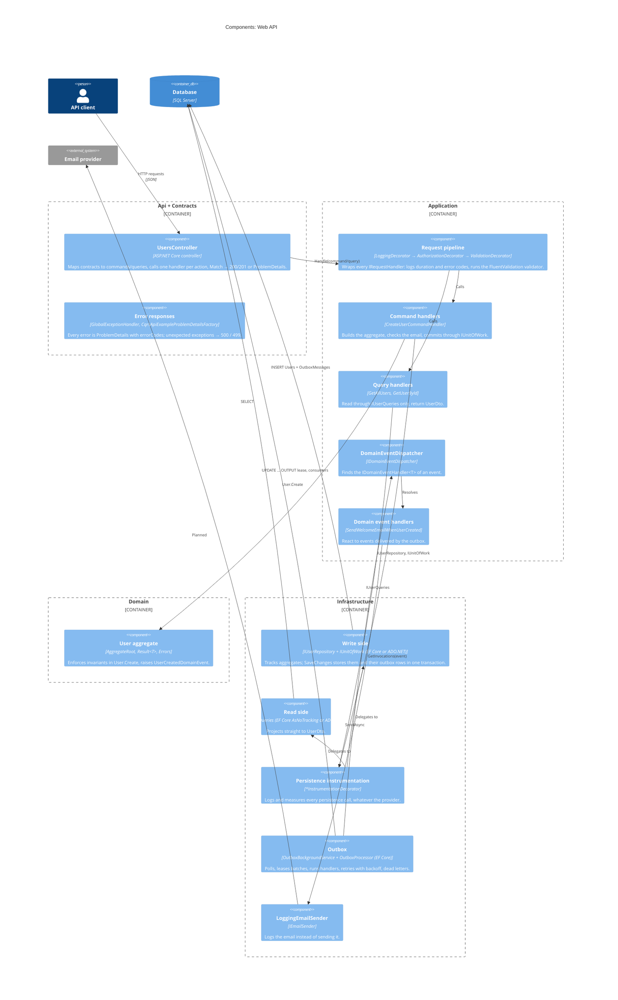
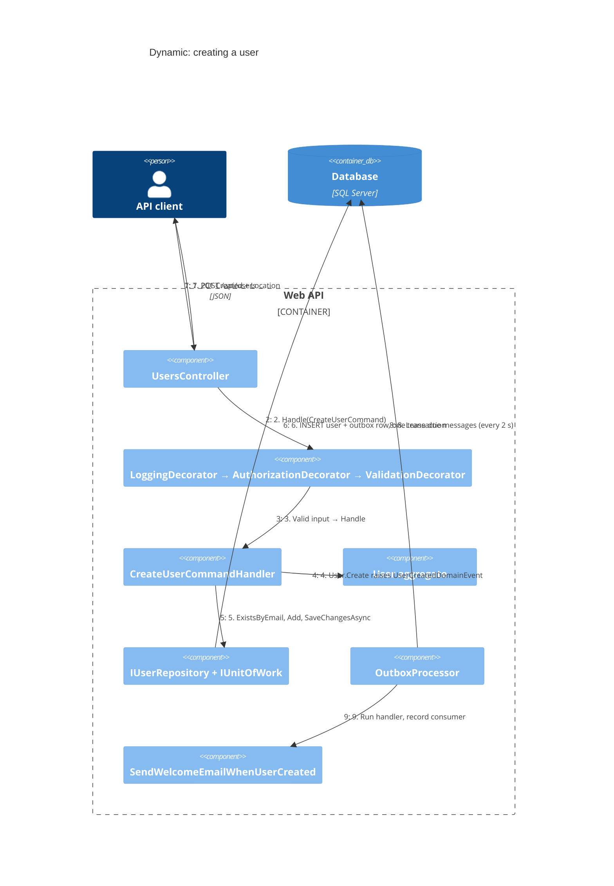
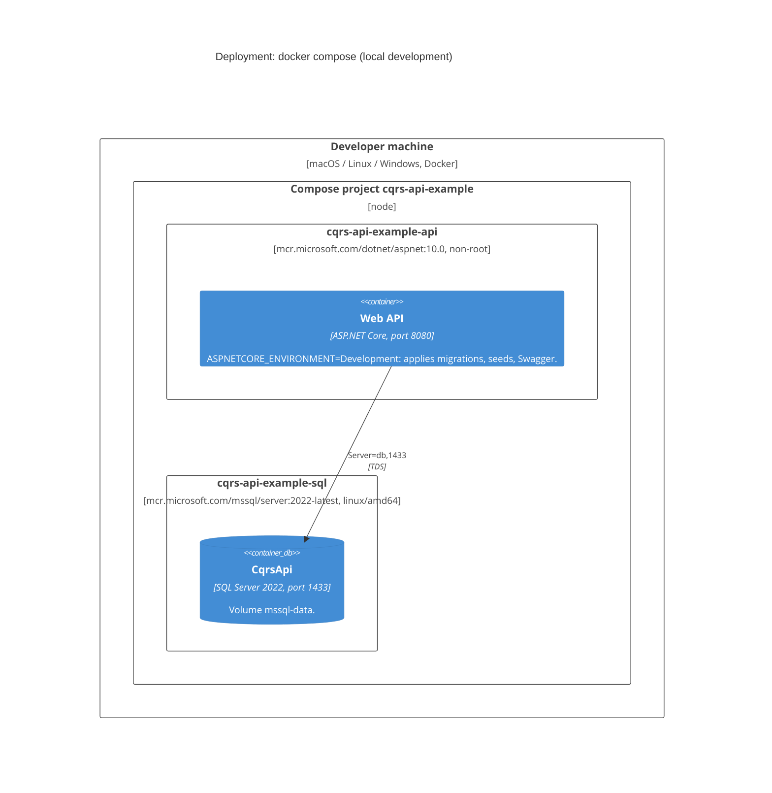
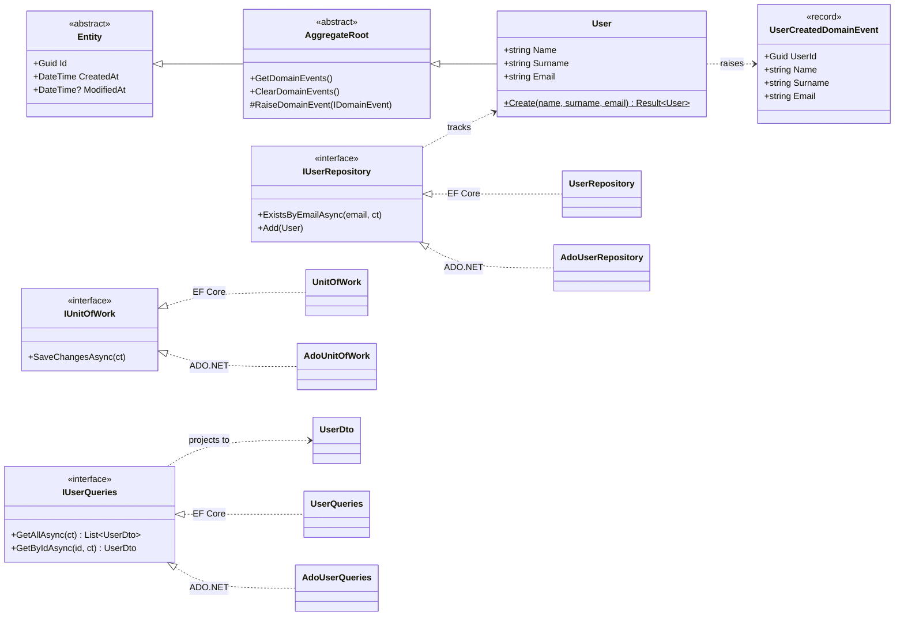

# CqrsApiExample: C4 model

*Português: [c4-model.pt-br.md](c4-model.pt-br.md)*

Architecture diagrams following the [C4 model](https://c4model.com): system context, containers,
components and code, plus a dynamic view of `POST /api/users` and the local deployment.
The diagrams are [Mermaid C4](https://mermaid.js.org/syntax/c4.html), which GitHub and most
Markdown previews render.

For the rules behind each box (why there is no mediator, how the outbox guarantees delivery,
how the provider flag works) see `CLAUDE.md`.

## Level 1: System context

Who uses the system and what it talks to.

## Level 2: Containers

The system is one ASP.NET Core process and one SQL Server database. The outbox worker is a
hosted service **inside** the API process, not a separate deployable.

| Container | Technology | Responsibility |
|---|---|---|
| Web API | .NET 10, ASP.NET Core (projects Api, Contracts, Application, Domain, Infrastructure) | HTTP endpoints, use cases (commands/queries), domain model, persistence, outbox worker |
| Database | SQL Server 2022 (`cqrs-api-example-sql`, host port 14330 locally) | Users (`[Accounts].[Users]`) and the transactional outbox (`[Messaging].*`) |

## Level 3: Components of the Web API

Grouped by project (Clean Architecture: dependencies point inward, to the Domain).
The controller receives the handler through `[FromServices]`; there is no mediator.

`errorHandling` has no arrows on purpose: it is ASP.NET Core middleware and factories that
answer any exception or error the controller and the framework produce.

| Component | Where | Notes |
|---|---|---|
| UsersController | `src/Api/Controllers/UsersController.cs` | `[FromServices] IRequestHandler<TRequest, Result<T>>` per action |
| Error responses | `src/Api/Common/Errors/` | `ErrorType` → 400/404/409/500; `RequestErrors` for routing errors |
| Request pipeline | `src/Application/Common/Decorators/`, `src/Application/DependencyInjection.cs` | Decorators built at startup by assembly scanning |
| Command handlers | `src/Application/Users/Commands/` | Return `Result<UserDto>`, never entities |
| Query handlers | `src/Application/Users/Queries/` | Never use `IUserRepository` (architecture test) |
| Domain event dispatch | `src/Application/Common/Events/`, `src/Application/Users/Events/` | Handlers must tolerate repeats (at-least-once) |
| User aggregate | `src/Domain/UserAggregate/` | Package-free, persistence-ignorant |
| Write / read side | `src/Infrastructure/Persistence/` (`Repositories`, `Queries`, `Ado/`) | `Persistence:Provider` = `Ado` or `EfCore` |
| Instrumentation | `src/Infrastructure/Persistence/Decorators/`, `Instrumentation/` | Histogram `cqrsapi.persistence.operation.duration` |
| Outbox | `src/Infrastructure/Outbox/` | Always EF Core, `UPDLOCK, READPAST` leases |

## Dynamic view: `POST /api/users`

The request returns as soon as the user and its event are committed; the welcome email is sent
later by the outbox, in another scope.

Failure paths: invalid input stops at step 3 (400 `User.Invalid*`); a duplicate email stops at
step 5 or, under concurrency, at step 6 through `UniqueConstraintViolationException` (409
`User.DuplicateEmail`, nothing stored); a failing event handler is retried with exponential
backoff and dead-lettered after 10 attempts.

## Deployment: local Docker Compose

Host ports bind to `127.0.0.1` only: the API on **5235** (→ 8080) and SQL Server on **14330**
(→ 1433, `MSSQL_HOST_PORT`). The API waits for the database healthcheck. Outside Development
nothing is migrated automatically.

## Level 4: Code (selected)

Only the parts worth a picture: the domain model and the persistence abstractions the
Application owns. Everything else is better read in the code.

