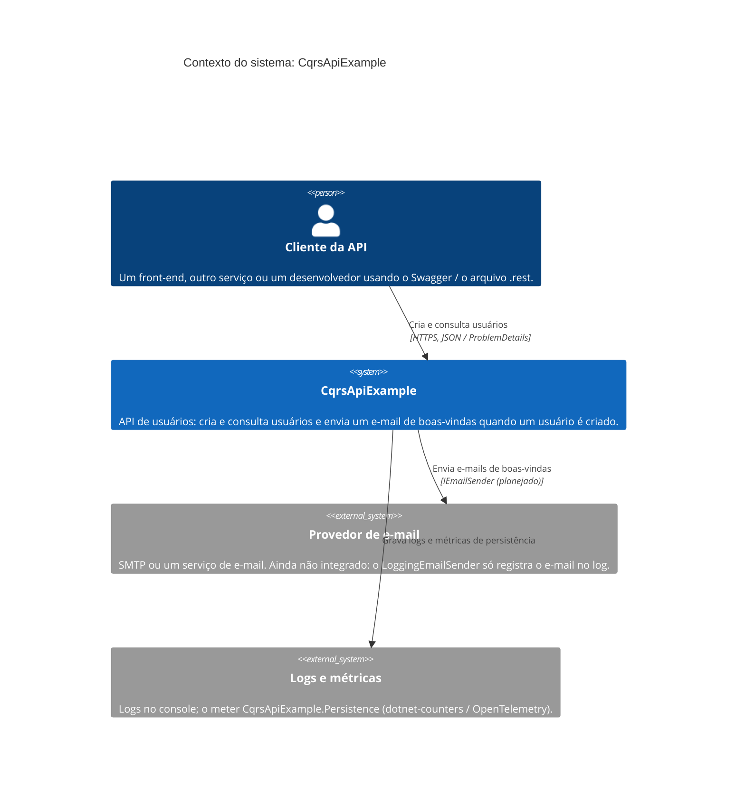
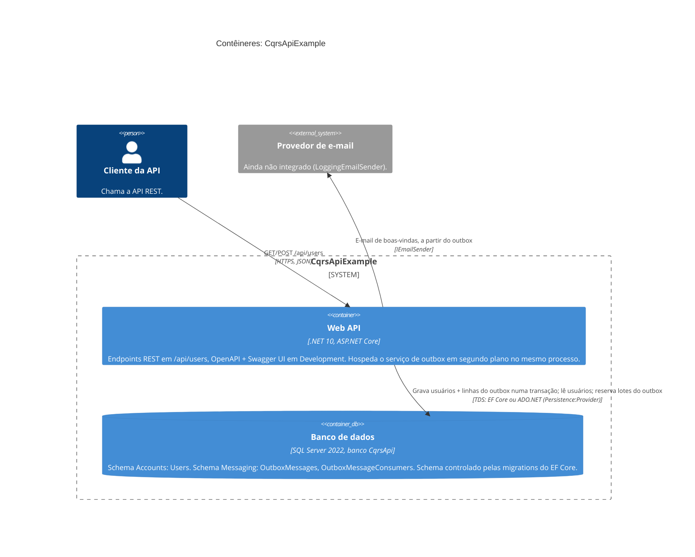
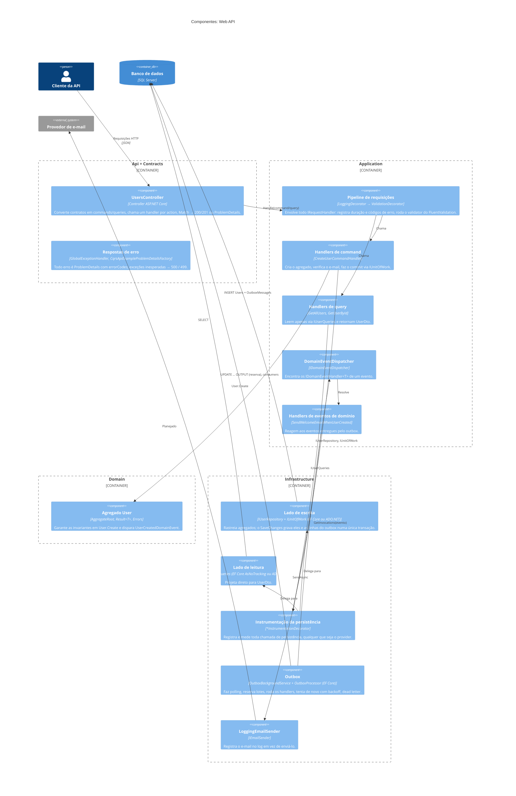
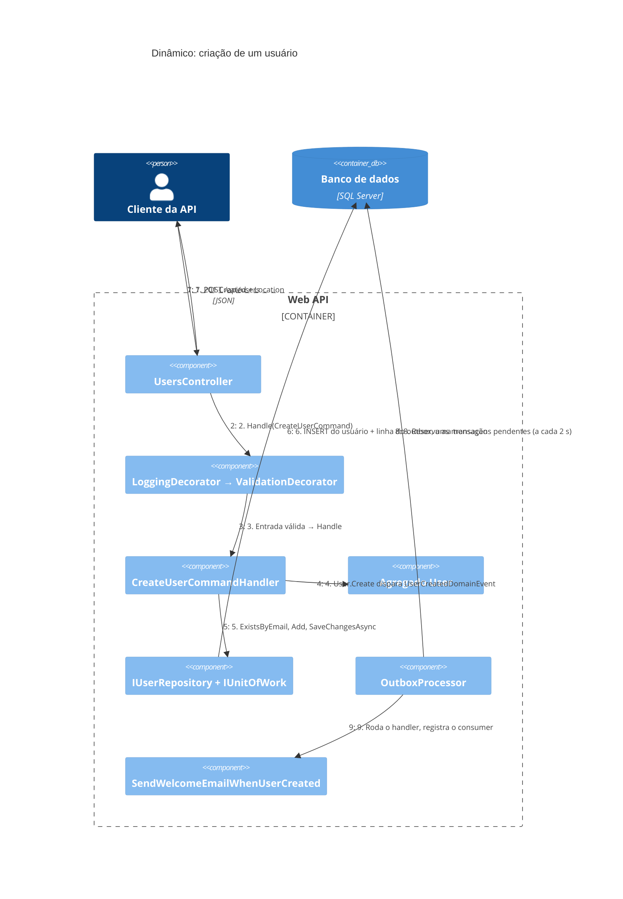
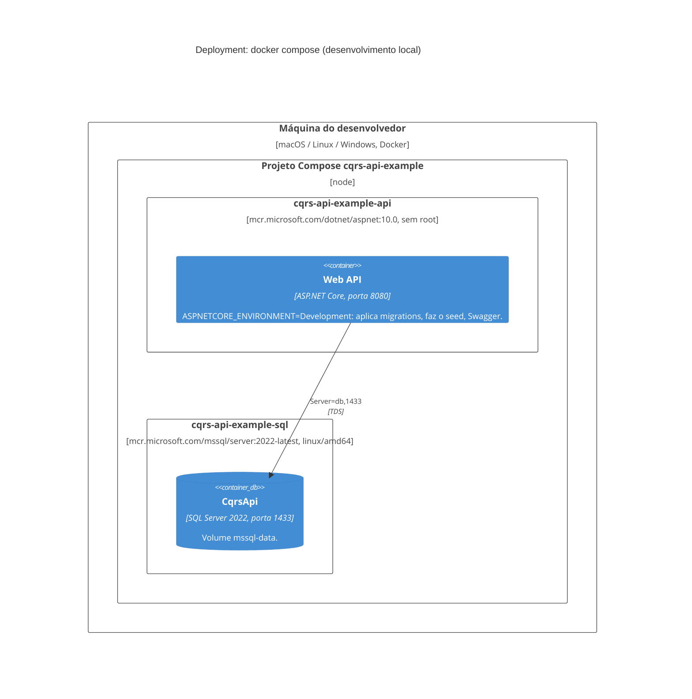
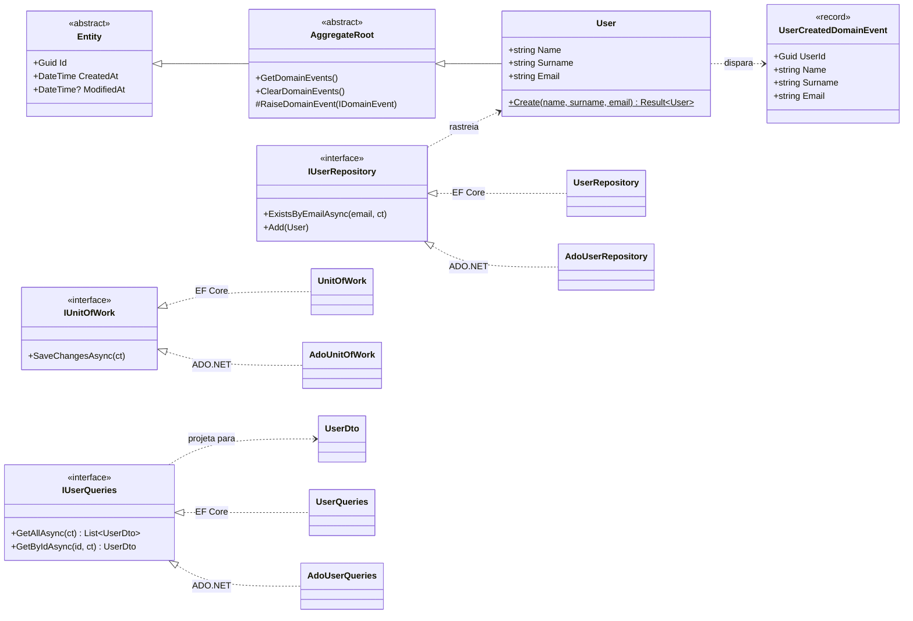

# CqrsApiExample: modelo C4

*English: [c4-model.md](c4-model.md)*

Diagramas de arquitetura seguindo o [modelo C4](https://c4model.com): contexto do sistema,
contêineres, componentes e código, além de uma visão dinâmica do `POST /api/users` e do
deployment local. Os diagramas usam [Mermaid C4](https://mermaid.js.org/syntax/c4.html), que o
GitHub e a maioria dos visualizadores de Markdown renderizam.

As regras por trás de cada caixa (por que não há mediator, como o outbox garante a entrega,
como funciona a flag de provider) estão no `CLAUDE.md`.

## Nível 1: Contexto do sistema

Quem usa o sistema e com o que ele se comunica.

## Nível 2: Contêineres

O sistema é um processo ASP.NET Core e um banco SQL Server. O worker do outbox é um hosted
service **dentro** do processo da API, não algo publicado à parte.

| Contêiner | Tecnologia | Responsabilidade |
|---|---|---|
| Web API | .NET 10, ASP.NET Core (projetos Api, Contracts, Application, Domain, Infrastructure) | Endpoints HTTP, casos de uso (commands/queries), modelo de domínio, persistência, worker do outbox |
| Banco de dados | SQL Server 2022 (`cqrs-api-example-sql`, porta 14330 no host local) | Usuários (`[Accounts].[Users]`) e o outbox transacional (`[Messaging].*`) |

## Nível 3: Componentes da Web API

Agrupados por projeto (Clean Architecture: as dependências apontam para dentro, para o Domain).
O controller recebe o handler via `[FromServices]`; não há mediator.

`errorHandling` não tem setas de propósito: são middleware e factories do ASP.NET Core que
respondem a qualquer exceção ou erro produzido pelo controller e pelo framework.

| Componente | Onde | Observações |
|---|---|---|
| UsersController | `src/Api/Controllers/UsersController.cs` | `[FromServices] IRequestHandler<TRequest, Result<T>>` por action |
| Respostas de erro | `src/Api/Common/Errors/` | `ErrorType` → 400/404/409/500; `RequestErrors` para erros de roteamento |
| Pipeline de requisições | `src/Application/Common/Decorators/`, `src/Application/DependencyInjection.cs` | Decorators montados no startup por varredura do assembly |
| Handlers de command | `src/Application/Users/Commands/` | Retornam `Result<UserDto>`, nunca entidades |
| Handlers de query | `src/Application/Users/Queries/` | Nunca usam `IUserRepository` (teste de arquitetura) |
| Despacho de eventos de domínio | `src/Application/Common/Events/`, `src/Application/Users/Events/` | Handlers precisam tolerar repetição (at-least-once) |
| Agregado User | `src/Domain/UserAggregate/` | Sem pacotes, sem conhecimento de persistência |
| Lados de escrita / leitura | `src/Infrastructure/Persistence/` (`Repositories`, `Queries`, `Ado/`) | `Persistence:Provider` = `Ado` ou `EfCore` |
| Instrumentação | `src/Infrastructure/Persistence/Decorators/`, `Instrumentation/` | Histograma `cqrsapi.persistence.operation.duration` |
| Outbox | `src/Infrastructure/Outbox/` | Sempre EF Core, reservas com `UPDLOCK, READPAST` |

## Visão dinâmica: `POST /api/users`

A requisição responde assim que o usuário e seu evento são gravados; o e-mail de boas-vindas
é enviado depois pelo outbox, em outro escopo.

Caminhos de falha: entrada inválida para no passo 3 (400 `User.Invalid*`); um e-mail duplicado
para no passo 5 ou, sob concorrência, no passo 6 via `UniqueConstraintViolationException` (409
`User.DuplicateEmail`, nada é gravado); um handler de evento que falha é tentado de novo com
backoff exponencial e vai para dead letter após 10 tentativas.

## Deployment: Docker Compose local

As portas do host ficam ligadas só em `127.0.0.1`: a API na **5235** (→ 8080) e o SQL Server na
**14330** (→ 1433, `MSSQL_HOST_PORT`). A API espera o healthcheck do banco. Fora de Development
nenhuma migration é aplicada automaticamente.

## Nível 4: Código (seleção)

Só as partes que valem uma figura: o modelo de domínio e as abstrações de persistência que
pertencem à Application. O resto se lê melhor no próprio código.

